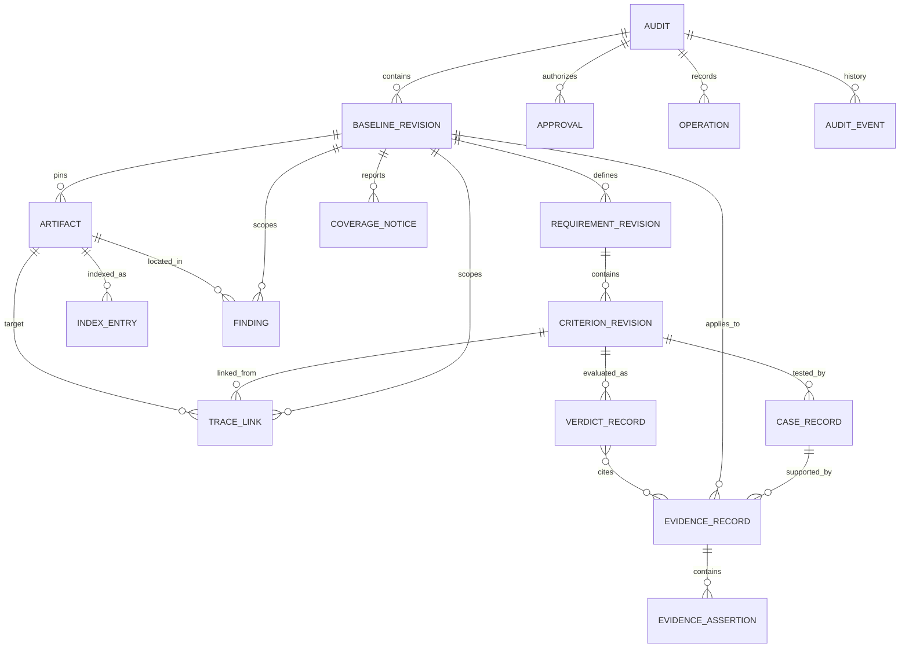

# SG-04A Logical Data Model

**Status:** Design document prepared for product-owner approval. Logical model only; no database or storage implementation has been selected or tested. D01 and D11 remain open.

## Modeling rules

- Every mutable workflow record is scoped to an `audit_id`; every source observation/evidence record references an immutable `baseline_revision_id`.
- Baselines pin the full Git commit/tree identity, exact accepted specification bytes and digest, normalized requirement/criterion revisions, analyzer/policy versions, and coverage notices.
- IDs are stable within their declared scope. Semantic edits create new requirement/criterion revisions or lineage records; they do not overwrite history or reuse retired IDs.
- Artifacts and evidence are content-digested. A digest mismatch marks the record altered and inadmissible for verdict support.
- Rejected specification bytes are never represented as a persisted entity. Accepted specification artifacts retain exact bytes; derived parsed records refer back to byte offsets/locations.
- Provider proposals and runner attempts remain separate evidence classes with explicit approval/provenance records.

## Entity relationship sketch

## Proposed records and constraints

| Record | Required identity and core fields | Integrity and lifecycle constraints |
|---|---|---|
| `Audit` | `audit_id`, creation time, current revision pointer, audit schema version | Created as draft; activated only after baseline inputs validate; prior revisions remain addressable |
| `BaselineRevision` | `baseline_revision_id`, audit ID, full commit/tree ID, accepted spec digest/format, analyzer and verification-policy versions, coverage state | Immutable once activated; changed commit/spec/policy creates a new revision and applicability review |
| `RequirementRevision` | requirement ID, semantic revision, priority, type, canonical record digest, source location, lifecycle state, predecessor IDs | Stable IDs follow the catalog contract; retired IDs cannot be reused |
| `CriterionRevision` | criterion ID/revision, parent requirement revision, expected outcome, verification method, source location, applicability | Verdicts and evidence bind to this exact revision |
| `Artifact` | audit ID, baseline ID, artifact ID, source kind, normalized snapshot path or external-source locator, kind, content digest, byte length, storage reference | Repository artifacts resolve within the pinned snapshot; accepted external specification artifacts retain a safe source locator and exact bytes; unsafe/rejected source has no persisted artifact |
| `IndexEntry` | artifact, language/framework, symbol or test identity, normalized source range, support classification | Derived from static indexing; no application import/execution; index version recorded |
| `TraceLink` | criterion/requirement revision, target artifact/location, origin, signal, review state, reviewer/rationale | Candidate, AI-inferred, confirmed, rejected and dismissed remain distinct; no candidate implies verification |
| `Finding` | stable finding ID, baseline, rule/version, target path/range, category, review state | Deterministic key includes baseline, rule and normalized location; dismissal does not change criterion verdict |
| `CaseRecord` | draft/approved case ID, criterion revision, rule/condition, declared expected outcome, test identity, reviewer | Draft cannot execute or support verdict; adoption requires recorded reviewer approval |
| `EvidenceRecord` | evidence ID/type, baseline, source/provenance, observed result, acquisition time, digest, trust, freshness, applicability, sanitization | Original imported result remains inspectable; stale/altered/incomplete evidence is not silently reused |
| `EvidenceAssertion` | evidence record, test/assertion identity, outcome, mapping/relevance state, reviewer rationale | A report-level pass without a relevant assertion cannot support a criterion |
| `VerdictRecord` | audit ID, baseline ID, criterion revision, verdict/reason, evaluator version, evidence-set digest, coverage-notice references, time | Derived and reproducible; records both supporting and conflicting evidence; never authored by AI provider response |
| `CoverageNotice` | stable notice ID, baseline, path/component, reason, affected criteria | Stable for same baseline; retained on reopen and included in export where applicable |
| `Approval` | approval ID/type, actor, audit, payload/invocation digest, endpoint/policy binding, state, expiry, consumption | Runner approval is consumed once; AI approval is rechecked against exact bytes, endpoint and current consent at dispatch |
| `Operation` | operation ID, audit ID, idempotency key, type, canonical input digest, state, sanitized error, linked outputs | Key is scoped by audit and type; same key with changed digest conflicts; retry is idempotent; failed operation cannot erase prior completed artifacts/evidence |
| `AuditEvent` | event ID, audit, actor, transition, timestamp, reason, related record IDs | Append-only logical history; no raw rejected source or secret values in event detail |

## Relationships and cardinality notes

- One audit has one or more baseline revisions; one baseline contains multiple requirement, criterion, artifact, index, link, finding, evidence, and coverage records.
- A requirement revision contains one or more criterion revisions. A criterion can have multiple trace links, cases, evidence assertions and historical verdicts.
- Evidence may cite an approved case and must identify the baseline and exact criterion revision to which it applies. Verdicts reference a set of evidence IDs and evaluator version, not a mutable “latest result” field.
- A trace link targets a repository artifact and location. Human review state is a separate field from link origin; AI-origin links remain inferred until reviewed.
- Audit events describe state changes but are not themselves proof of product behavior.

## Artifact and revision lifecycle

```mermaid
stateDiagram-v2
  [*] --> TransientIntake
  TransientIntake --> RejectedDiscarded: covered secret / inspection failure / invalid input
  TransientIntake --> AcceptedExactBytes: safe inspection and validation
  AcceptedExactBytes --> PinnedBaseline: digest + commit + criteria revisions
  PinnedBaseline --> Indexed: static inventory and coverage notices
  Indexed --> Reviewed: trace/finding/case decisions
  Reviewed --> EvidenceAdded: safe JUnit import or approved isolated run
  EvidenceAdded --> Evaluated: relevance, freshness, integrity and verdict rules
  Evaluated --> Exported: versioned JSON
  PinnedBaseline --> Superseded: new snapshot/spec semantic revision
  Superseded --> RetainedHistory: preserve old evidence; reassess applicability
```

The `RejectedDiscarded` state is transient operationally and must not be written into the persistent artifact store. A sanitized failure record may retain an operation ID, safe input identifier, rule/limit code and time, but not rejected values. The diagram does not select whether metadata uses a relational database, append-only files, or another local store.

## Open storage decisions

Database/file split, transactional boundary, schema migration strategy, encryption-at-rest, backup, retention/garbage collection and crash recovery remain unresolved. D11 requires round-trip, altered-artifact, stale-evidence, atomic failed-intake and idempotent retry demonstrations before implementation. No persistence feasibility claim is made.

## SG-04D domain contract additions (design proposal)

All decision-bearing identities use composite scope `(audit_id, baseline_id, object_id, revision)`. API references must resolve within that scope; an ID from another audit, a retired ID, a stale revision, or an illegal transition is rejected without changing the active baseline.

| Record | Required fields and transition | Integrity rule |
|---|---|---|
| `BaselineCandidate` | candidate ID, audit, source artifact, parent baseline, parsed catalog, semantic change set, state `staged/accepted/rejected` | Staging never activates a baseline. Activation is atomic and requires an approved reviewer decision. |
| `ClarificationDecision` | audit/baseline, requirement and criterion revision, classification, reviewer, rationale, source span, decision time | Clarification preserves the accepted wording; any semantic change routes through `BaselineCandidate`. |
| `SemanticChange` | prior/new criterion revisions, change type `correction/addition/replacement/split/retirement`, affected IDs, rationale | Retired IDs cannot be silently reused; each child/replacement points to its parent and decision. |
| `TraceLinkDecision` | audit/baseline, criterion revision, target identity, origin, decision `confirm/reject/dismiss`, reviewer, rationale, expected prior revision | Manual links and dismissal are persisted actions; stale concurrent decisions conflict. |
| `RuleRevision` | criterion revision, family, typed field/domain, exact bounds, declared states/transitions, explicit outcomes, revision | Contradictory or underspecified rules are invalid; cases reference this exact revision. |
| `CaseRevision` | rule revision, criterion revision, draft/approved/retired state, typed input, expected outcome, reviewer decision | Draft is non-executable and inadmissible; approval does not itself launch a runner. |
| `EvidenceAssessment` | source outcome, inspected assertion/observation, mapping, relevance and rationale, baseline freshness, integrity, completeness, reviewer | Importer-supplied admissibility flags are never authoritative. Preserve source outcome even if rejected for verdict support. |
| `ProviderProposal` | audit/baseline, endpoint/payload digests, schema version, validated candidate references/spans, taint label, review state | Remains inferred/untrusted; it cannot create evidence, tool calls, approvals, execution, or verdict input. |
| `RunnerAttempt` | attempt ID, audit/baseline, invocation and environment digests, consumed approval ID, durable state, limits, cleanup status | One approval authorizes one attempt; uncertain cleanup blocks all subsequent service runs until verified recovery. |

The record list makes the approved workflow expressible but does not select a persistence engine, authenticate imported test authors, or establish atomicity. D05 and D11 remain open pending controlled evidence.

