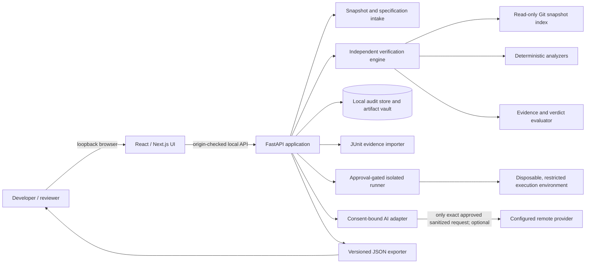
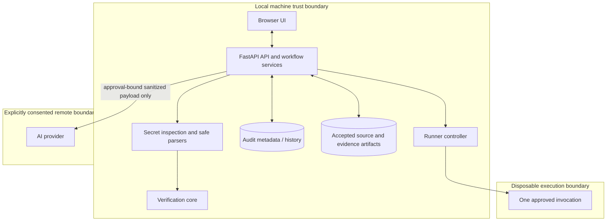

# SG-04A System Architecture and Technical Design (approval draft)

**Status:** SG-04A design package prepared for product-owner approval. No architecture decision in this document closes an SG-03D condition or authorizes SG-05 implementation.  
**Lifecycle/task:** Design, SG-04A.  
**Baseline:** SG-03D closed requirements for Design entry; 54 requirements, 68 criteria, 68 test-plan cases; 12 mandatory M3 conditions remain OPEN.  
**Starting commit:** `81ff5ff03d1b5ee859f23ed6eb38306df64483d9`.

## 1. Design intent and boundaries

This proposal keeps the approved local-first audit product: a loopback web application, Python/FastAPI backend, React/Next.js frontend, an independent verification engine, Markdown/YAML specifications, source indexing, requirement-to-code-to-test traceability, ghost implementation detection, imported JUnit evidence, explicitly approved isolated test execution, Git-pinned audit history, optional per-audit remote AI suggestions, and machine-readable export.

The architecture presents evidence and unresolved gaps. It does not certify correctness or make release decisions. Deterministic rules produce reproducible observations. Human review owns interpretation and adoption. AI can propose trace links only; it cannot create evidence, alter a verdict, or approve an action.

This is a design proposal. SG-04R records preferred implementation choices and proposed defaults for parser/library choices, runner platform, numeric resource limits, persistence mechanics, and detector coverage. They remain unverified runtime settings; empirical evidence is still required before activating sensitive capabilities. No requirements, priorities, milestones, acceptance criteria, or product-owner decisions are changed here. There is no calendar-based scope reduction.

## 2. Context and container architecture



The browser and local API are the only interactive surface. The API binds to loopback and applies the approved local-session, Host/Origin, and proof checks before protected reads or mutations. The verifier consumes immutable, identified audit inputs and produces typed observations; it has no authority to execute repository modules, transmit data, or set reviewer decisions. The runner and provider adapter are separate capability boundaries reached only through explicit approval state.



The exact placement and technology of the store, vault, parser sandbox, and runner remain undecided pending M3 proofs. The diagram shows responsibility and trust boundaries, not a claim that a selected implementation has passed isolation validation.

## 3. Components and module boundaries

| Component | Owns | Must not own |
|---|---|---|
| Local web/API shell | Loopback startup, session/origin proof, request validation, orchestration, safe errors | Analyzer logic, arbitrary filesystem access, runner execution in-process |
| Audit workflow service | Audit state transitions, retries, revisions, approval records, idempotency | Directly interpreting source or deciding product release readiness |
| Git snapshot adapter | Resolve full commit/tree, read in-scope objects, normalize snapshot paths and locations | Fetching, modifying the source repository, following path escapes, reading working tree/untracked files |
| Specification intake | Inspect bytes before persistence, format detection, Markdown/YAML validation, exact accepted-byte digest and locations | Retaining rejected bytes, silent redaction-and-acceptance, claiming universal secret detection |
| Source indexer | Static inventory and stable locations for supported Python/FastAPI and React/Next.js artifacts and tests | Importing or executing application modules |
| Deterministic analyzer | Exact-ID candidates, documented ghost rules, rule-derived case drafts, stable finding identifiers | Promoting candidate links, inferring undeclared outcomes, changing requirements |
| JUnit importer | Safe XML parsing, result identity/outcome, report provenance and assertion details when present | Treating report-level pass as proof of every criterion |
| Evidence mapper/reviewer | Link imported evidence to audit, baseline, case, criterion, assertion and reviewer decision | Altering original imported result or provenance |
| Evidence and verdict evaluator | Applicability, provenance, relevance, freshness, trust, coverage notices, verdict and reason | Treating AI suggestions, candidate links, stale or unsupported evidence as proof |
| Isolated runner controller | Invocation digest, single-use approval, backend lifecycle, limits, output capture, teardown/recovery state | Host fallback, provider calls, reusable approval after changed invocation |
| AI proposal adapter | Payload construction/redaction, endpoint display, consent binding, constrained request/response validation | Verdict changes, auto-link adoption, redirects, request without current matching consent |
| Persistence and artifact vault | Versioned audit metadata, immutable evidence/artifact references, history and integrity digests | Rejected specification content or unredacted unsafe evidence |
| Exporter | Versioned machine-readable snapshot of audit, verdicts, notices, links and evidence references | Raw rejected secret content, unreviewed model payloads, mutation of audit state |
| React/Next.js UI | Intake, workflow, trace review, findings, evidence, approvals, history and export views | Rendering untrusted markup as active content or implying that suggestions are verified |

Keep the verification core as a Python package with explicit input/output contracts and no FastAPI, browser, database, provider, or runner-control imports. Adapters translate external records into versioned domain types. This is a proposed dependency rule; M3 fixture proofs must establish its practical form.

## 4. End-to-end verification lifecycle

1. **Establish local session.** Browser obtains a short-lived local proof. The service checks loopback bind, Host, Origin, request method and proof before protected disclosure or mutation.
2. **Pin repository baseline.** Select a full Git commit. Read only the committed tree through the snapshot adapter. Reject a missing/malformed required object, unsupported escape, symlink traversal or submodule contents without fetching or changing source or the prior audit.
3. **Inspect specification before persistence.** Receive Markdown/YAML bytes into a bounded transient intake buffer. Run mandatory covered-secret inspection before parser, cache, log, evidence, export, persistence, or provider path. On detection or inability to establish a safe inspection result, discard input and return a sanitized diagnostic requiring sanitized resubmission. For accepted input only, retain and hash the exact source bytes and source locations.
4. **Parse and validate.** Enforce supported format/version, size/depth/duplicate-ID and safe-data rules. Produce normalized requirement and criterion records with source offsets and semantic revisions. Do not fetch external resources. A failed step adds no partial baseline and leaves earlier audits intact.
5. **Build static index.** Inventory supported source and test artifacts without importing/running application code. Emit stable paths, locations, framework coverage and unsupported-scope notices.
6. **Generate deterministic observations.** Run exact-ID trace candidate and documented ghost rules. Generate adversarial case drafts only for confirmed structured rules and declared outcomes. Each observation has rule/version, input baseline digest, artifact path/location and stable ID. Candidate or draft status is explicit.
7. **Review trace and drafts.** Reviewer confirms, rejects, dismisses or edits the record with attribution and rationale. Manual links remain available. Remote AI, if enabled for this audit, separately previews exact sanitized bytes and destination; dispatch rechecks current consent, audit, payload and endpoint. Responses are validated against pinned IDs and index locations and stay inferred/awaiting review.
8. **Import or execute verification evidence.** JUnit import retains report provenance and case-level outcomes. A passing report contributes only if an admissible assertion maps to the criterion/case and is relevant to the same baseline. An existing command may run only after exact invocation approval for one attempt, with the selected supported sandbox and limits. Any setup/teardown uncertainty blocks execution and never falls back to host execution.
9. **Evaluate evidence and verdicts.** Evaluate per criterion with coverage, applicability, integrity, relevance, freshness, support and trust. Preserve failed, incomplete and unresolved distinctions; provider results do not enter verdict inputs.
10. **Persist history and export.** Commit workflow results atomically per operation, retain prior evidence and revisions, mark superseded evidence stale rather than deleting history, and emit versioned JSON. A failed retry must not duplicate evidence.

```mermaid
sequenceDiagram
  actor D as Developer
  participant UI as Local UI
  participant API as API/workflow
  participant I as Secret-safe intake
  participant G as Git snapshot adapter
  participant V as Verification core
  participant S as Store
  participant R as Runner / provider adapter
  D->>UI: Start audit and select commit/spec
  UI->>API: Request with local session proof
  API->>G: Resolve and pin commit
  G-->>API: Snapshot identity / safe failure
  API->>I: Transient specification bytes
  I->>I: Inspect covered secrets before persistence
  alt detected secret or inspection incomplete
    I-->>UI: Sanitized reject; request sanitized resubmission
  else accepted source
    I-->>API: Exact bytes, digest, parsed records, locations
    API->>V: Immutable baseline + indexed artifacts
    V-->>API: Deterministic findings, trace candidates, drafts
    API->>S: Atomic audit revision and provenance records
    API-->>UI: Reviewable audit state
    opt explicit operation approval
      UI->>API: Approve exact run or exact AI payload/destination
      API->>R: Recheck binding and execute one bounded operation
      R-->>API: Provenanced result or safe incomplete/failure
      API->>S: Preserve result and re-evaluate deterministic verdicts
    end
  end
```

## 5. Persistence model and artifact lifecycle

Proposed logical entities (not a selected SQL schema):

| Entity | Key fields and relationship |
|---|---|
| `Audit` | `audit_id`, created time, schema version, current revision; owns one or more baseline revisions |
| `BaselineRevision` | revision ID, full Git commit/tree identity, exact accepted spec digest/format, analyzer and policy versions, coverage status; immutable after activation |
| `RequirementRevision` / `CriterionRevision` | stable IDs, semantic revision, source location, canonical content digest, active/retired state and predecessor lineage |
| `Artifact` | artifact ID, baseline ID, normalized snapshot path, kind, content digest, size and safe storage reference; accepted source bytes kept byte-exact |
| `IndexEntry` | baseline, artifact, language/framework, symbol/test identity, normalized location, supported/unsupported classification |
| `TraceLink` | requirement/criterion, artifact or test reference, signal origin, review state, reviewer/rationale, baseline and location |
| `Finding` | stable finding ID, rule/version, target artifact/location, severity/category, review state, baseline digest |
| `CaseDraft` / `ApprovedCase` | criterion revision, declared rule and condition, explicit expected outcome, status, reviewer and lineage |
| `EvidenceRecord` | evidence ID, kind, baseline, case/criterion mapping, provenance, observed outcome, integrity digest, timestamps, trust and applicability state |
| `EvidenceAssertion` | report/test identity, assertion identity and observed assertion detail where available; links report evidence to a specific expected behavior |
| `CoverageNotice` | stable notice ID, baseline, path/component, reason and affected criteria |
| `Approval` | one-time runner invocation binding or AI payload/endpoint/audit byte binding, approver, state, expiry and consumption time |
| `Operation` | idempotency key, operation type, state, sanitized failure, linked input/output evidence; supports retry without duplicate results |
| `AuditEvent` | append-only state transition, actor, time, reason and prior/new record references; never includes rejected source or secret values |

Relationships: an audit contains immutable baseline revisions; each revision contains specification requirement/criterion revisions, artifacts, index entries and notices. Trace links and findings point to a specific baseline and source location. Evidence belongs to a baseline and may reference an approved case and a specific assertion. Verdicts are derived records that reference the exact evidence set and evaluator version. Approval records are single-purpose and consumed once (runner) or revalidated at dispatch (AI). New snapshots/spec revisions create new baseline revisions; old evidence stays addressable and becomes stale for new criteria where applicability changed.

Artifact lifecycle: transient bounded intake → mandatory inspection → reject and discard, or accepted exact bytes → content-addressed/integrity-checked artifact → indexed references → derived observations/evidence → versioned export. Import/run output passes redaction and validation before persistence. Unsafe/unredactable affected content is withheld. Failed intake is atomic. Rejected source never enters persistent storage, logs, caches, exports, session evidence or provider payloads.

Storage technology, encryption-at-rest needs, file-vs-database split, garbage-collection rules and backup behavior remain design decisions. They must preserve local ownership, exact accepted bytes, immutable provenance and the D11 proof. The expanded logical schema and relationship diagram are in [SG-04A data model](SG-04A-data-model.md).

## 6. Requirement-to-code-to-test traceability

Trace edges are typed and baseline-scoped: `criterion → source artifact`, `requirement/criterion → test artifact`, `approved case → executable test identity`, and `assertion → criterion/case`. Each edge stores origin (`exact-id`, deterministic rule, manual, or AI-inferred), signal, snapshot commit, normalized path/location, analyzer/version, review state and reviewer attribution. Exact identifiers create candidates. Only reviewer-confirmed or manual links become confirmed trace links. AI remains inferred until the same review step.

Source index records are static observations, not proof of behavior. A test identity is distinct from a report result and from an assertion. A report-level green status cannot cover requirements without relevant assertions. A failed admissible assertion can support a failed criterion; a passing but unrelated assertion remains inspectable yet cannot support a verdict. Identity/revision changes and changed source artifacts trigger applicability reassessment while retaining old links and evidence under their original baseline.

The companion [SG-04A architecture traceability matrix](SG-04A-architecture-traceability.csv) maps each of the 68 criterion IDs (therefore all 54 requirement IDs) to the proposed components and the existing test-plan case/method. It is a plan, not evidence that any case was run.

## 7. Deterministic verification and AI proposals

| Deterministic path | AI-assisted path |
|---|---|
| Snapshot/path rules, parser schema and limits, static inventory, exact-ID matches, documented ghost patterns, structured case generation, evidence applicability and verdict policy | Candidate trace suggestions for reviewer consideration only |
| Reproducible for identical pinned inputs/configuration; findings identify rule/version and locations | Optional, disabled by default, consent-controlled for each audit and exact payload/destination |
| Can contribute typed evidence only through approved deterministic or human-reviewed workflows | Cannot create test execution evidence, approve links, alter verdicts or bypass unsupported/incomplete states |
| Malformed, unsupported, stale or contradictory input yields explicit failure/unresolved state | Invalid references or provider failure are rejected; valid proposals stay inferred and awaiting review |

The AI request builder receives only approved excerpts after redaction and validation. The preview is the exact outbound payload and endpoint including scheme, host, port, path and query. Approval binds audit ID, payload bytes and endpoint; dispatch rechecks them and current consent. No redirects are followed. Timeout, HTTP error, malformed response, oversize body or invalid references produce a visible sanitized failure while preserving prior evidence and verdicts. Deterministic and manual workflows remain usable during provider failure.

## 8. Evidence provenance, relevance, freshness and trust

Every evidence record carries: producer/source, original identity, baseline and content digest, artifact/test/assertion identity, acquisition/import/run time, invocation/environment or provider metadata as applicable, parser/analyzer/policy version, reviewer mapping decision, integrity status, relevance rationale, freshness/applicability status, coverage notices and sanitization state. Derived evidence points to its parent observation and never overwrites source evidence.

- **Provenance:** distinguish imported report, controlled runner result, deterministic static finding, manual review and AI proposal. Preserve the raw result only after required safe parsing/redaction; keep provider payloads out of persistent evidence unless explicitly permitted by the approved baseline (currently unreviewed model payloads are excluded from export).
- **Relevance:** require matching baseline and a specific test/assertion mapped to criterion or approved case. Mapped/unmapped and relevant/irrelevant decisions are inspectable with reviewer rationale. A passing unrelated assertion does not support verification.
- **Freshness:** evidence applies to the baseline/revision it names. Changed specification semantics, source commit, test artifact or invocation marks affected evidence stale or requiring reassessment. Never silently carry forward a verdict.
- **Trust:** deterministic observation and controlled execution remain separate types. Human-confirmed links are distinct from candidates. Imported data is untrusted until parsed, integrity checked, mapped and judged relevant. AI output remains untrusted/inferred regardless of provider confidence.
- **Integrity:** verify content digests when reopening; altered artifacts are excluded from verification and shown with reason. Retain the original imported outcome and provenance when assertion relevance fails.

## 9. Verdict calculation

Verdicts are per criterion, derived from admissible evidence for that exact criterion revision and baseline. No aggregate score can override an unresolved P0 item. The approved `docs/VERIFICATION_POLICY.md` is normative; the following design interpretation preserves its fail-closed behavior:

1. **Failed** when current, relevant, integrity-valid evidence directly demonstrates a mismatch with the expected outcome and there is no unresolved contradiction. Preserve contrary evidence and explain the conflict; do not average it away.
2. **Verified** only when current, relevant, integrity-valid evidence directly supports the expected outcome, coverage is sufficient, and there is no unresolved conflicting evidence. Static trace candidates, presence of source, report-level pass, manual dismissal and AI proposals do not alone qualify.
3. **Unresolved** when evidence is absent, incomplete, unsupported-dependent, stale, corrupted, unmapped, irrelevant, ambiguous, conflicting without an admissible resolution, or execution/import was blocked or incomplete. Attach the specific reason and relevant coverage notice IDs.
4. **Unsupported-only audit** has an unsupported audit-level outcome and diagnostic export. Repository scope classification is independent of criterion evidence: an unsupported repository analysis does not by itself suppress sufficient, admissible, independent evidence for a criterion. If unsupported dependence leaves the criterion without sufficient evidence, it remains unresolved with the specific notice and reason. Do not turn absence of analysis into failure or verification.
5. **Partial coverage** continues for supported artifacts, while affected criteria with no sufficient independent evidence remain unresolved with scope notices. Directly mapped supported passing/failing assertions still follow normal rules.
6. **No applicable criteria** is “not applicable” for aggregate coverage, not 0% verified.

Manual demonstration outcomes follow the same explicit criterion, baseline, rationale and reviewer attribution policy defined by the normative verification policy. The architecture must not invent a more permissive evidence class.

## 10. API contracts, validation and errors

Proposed versioned JSON API (`/api/v1`); exact names are for review and may be adjusted without changing requirements. Responses use stable identifiers, explicit states, normalized paths and typed errors. Mutations require local-session proof, origin/Host checks, CSRF-resistant proof and idempotency keys where retry can duplicate work. See the standalone [SG-04A API contract](SG-04A-api-contracts.md) for schemas, state transitions and response examples.

| Contract | Purpose / validation |
|---|---|
| `POST /audits` | Create a draft audit from local repo identity and commit; validate repository selection and full commit resolution before activation |
| `POST /audits/{id}/specification` | Stream bounded Markdown/YAML bytes to transient secret inspection; no persistence until inspection and format validation succeed; accepted response returns digest and source locations, never rejected content |
| `POST /audits/{id}/index` | Build/rebuild static index for immutable baseline; idempotent per baseline and analyzer version |
| `GET /audits/{id}` and subresources | Read audit, requirements, links, findings, evidence, coverage, operation status and history after authorization checks |
| `POST /audits/{id}/links/{linkId}/review` | Confirm/reject/dismiss candidate with allowed transition, reviewer attribution and rationale |
| `POST /audits/{id}/cases/{caseId}/approve` | Adopt an edited case only after schema, criterion revision and explicit expected-outcome validation |
| `POST /audits/{id}/reports` | Bounded JUnit upload; reject invalid XML/external retrieval/expansion; retain no partial case results on invalid report |
| `POST /audits/{id}/runner-approvals` then `/runs` | Approve exact command/baseline/policy for one attempt; dispatch consumes once and verifies isolation before launch |
| `POST /audits/{id}/ai-preview`, `/ai-approvals`, `/ai-suggestions` | Build redacted exact preview, bind explicit consent, revalidate at dispatch, validate bounded response references; no redirects |
| `GET /audits/{id}/export?format=json&version=1` | Read-only versioned export; omit rejected source, unreviewed AI payloads and unsafe content |

Validation rules: reject unknown enum/version and duplicate IDs/keys; cap bytes/depth/counts; canonicalize and constrain all paths to pinned snapshot; reject path traversal and unsafe links; distinguish absent from empty and unsupported from malformed; validate all relationship IDs within the same audit/baseline; enforce legal state transitions and idempotent retries. Do not echo untrusted source or secret-bearing parser excerpts in error bodies.

Typed error envelope: `{code, safe_message, retryable, operation_id, affected_input, rule_or_limit, correlation_id}`. `affected_input` is a safe identifier/path where appropriate, never the secret value. Use 400 for invalid structure, 403 for failed local authority, 404 for unknown audit-scoped IDs, 409 for changed baseline/approval or illegal state, 413 for configured size limits, 422 for semantically unsupported input, 429 for bounded operation throttling if selected, and 500/503 for sanitized internal/dependency failure. Exact status mapping is a proposed API decision; error semantics and fail-closed behavior are required. No stack trace, credentials or untrusted raw content reaches user-visible response or logs.

## 11. Frontend information architecture and workflows

1. **Start audit:** repository/commit selection, specification upload, scope limits and privacy notice; reject screen gives only sanitized reason and clear resubmission action.
2. **Audit overview:** pinned commit/spec digest, audit progress, supported/partial/unsupported coverage notices, operation status and unresolved totals.
3. **Requirements:** filter by requirement, criterion, priority, feature and verdict; show original accepted criterion/revision and source location.
4. **Trace review:** candidate/confirmed/manual/AI-inferred links are visually distinct; side-by-side requirement and inert source excerpt with path/line; confirm/reject/dismiss with rationale.
5. **Findings and ghost candidates:** rule, exact location, evidence, scope limitation and review state; dismissal does not imply behavior verified.
6. **Test design:** requirement-derived draft cases, explicit conditions/outcomes, source criterion revision, approval controls and test references.
7. **Evidence:** imported report assertions, result provenance, mapping/relevance decision, freshness/integrity, and runner attempts/limits/teardown. Report green status alone is not a criterion verdict.
8. **Run approval:** exact invocation and one-attempt notice; isolation/limits status, approval consumption, incomplete/block/recovery reason.
9. **AI consent:** disabled-by-default state; exact sanitized payload and full endpoint; audit/payload/destination binding and revoke state; failures leave manual/deterministic paths visible.
10. **History and export:** immutable revisions, stale evidence explanations, audit comparison where in scope, JSON schema/version and downloadable diagnostics.

All imported Markdown, YAML, XML-derived text, source snippets, test output and provider responses render as escaped inert text. Avoid raw HTML or active links in untrusted content. Keyboard access, loading/error/empty states and distinction between “candidate”, “reviewed”, “verified”, “failed” and “unresolved” are part of workflow design. Visual Reality Check remains P1/M7; this architecture reserves its information-model boundary without moving it into MVP.

## 12. Security boundaries and failure handling

Threat inputs include malicious Git objects and paths, symlinks/submodules, hostile Markdown/YAML/JUnit, oversized/deep parser input, secrets in specs/logs/reports, browser-origin abuse, untrusted repository tests, runner setup/teardown failures, provider endpoint/payload mutation, redirects, malformed provider responses, and corrupted stored artifacts. The separate [SG-04A security design](SG-04A-security-design.md) records assets, boundaries, threats and failure responses.

Controls are layered: loopback-only listener and browser authority proof; pinned read-only Git object access; bounded safe parsers without external retrieval; specification secret inspection before persistence; inert UI rendering; artifact digests and atomic revisions; explicit single-use invocation approval; non-privileged disposable runner with no network/host credentials/writable source; bounded process/output/resources and verified teardown; persisted block across restart until recovery; redaction-before-evidence/provider; consent binding and redirect refusal; typed sanitized diagnostics; deterministic fallback; append-only audit history.

Failure policy: deny before disclosure or state change; reject incomplete secret inspection; reject malformed/oversized parsers atomically; mark any interrupted or limit-exceeded execution incomplete; block further execution if containment/teardown is uncertain; preserve earlier audit/evidence; withhold unsafe outbound content; retain current verdicts on provider failure; keep deterministic/manual review available. Never classify missing coverage or incomplete evidence as verified.

The controls above are proposed design intent. The 12 conditions define the required demonstrations. No isolation, detector, rendering, endpoint or feasibility result is claimed.

## 13. Requirement and condition coverage

See [SG-04A architecture traceability matrix](SG-04A-architecture-traceability.csv) for all 54 requirements and 68 acceptance criteria, with component mapping, catalog verification method and existing test-plan case. See [SG-04A mandatory-condition disposition](SG-04A-condition-matrix.md) for all 12 open conditions, proposed decisions, required proof, role owner and closure gate.

## 14. Dependencies, risks and unresolved decisions

| Decision / dependency | Current proposal | Risk / proof still required |
|---|---|---|
| Git, Markdown/YAML/JUnit parser libraries and numeric limits | Keep behind bounded adapters; choose after controlled samples | Object traversal, parser ambiguity/expansion, XML entities, resource exhaustion; D06 |
| Python and JS/TS static index/analyzers | Independent non-executing index; explicit rules and coverage states | Dynamic language/framework behavior and unstable locations; D02, D07 |
| Local persistence format and revision/atomicity | Versioned audit model with immutable baseline/evidence references | Crash consistency, migrations, retention and exact-byte source boundary; D11 |
| Secret detector classes/patterns | Configured bounded classes per approved decision | False negatives are possible; detector unavailability must fail closed; D01, D10 |
| Browser authority/session proof | Loopback with Host/Origin and revocable/expiring proof | Browser and local-origin attack surface; D08 |
| Runner host/backend | Keep controller isolated behind backend interface; no platform selected | Sandbox availability/escape, limits, process-tree teardown, restart recovery; D03, D09 |
| Provider transport | Exact endpoint/payload consent binding, bounded response, no redirects | DNS/endpoint validation, proxy behavior, credential handling and body limits; D10 |
| Fixture repository and integrated test harness | Select pinned synthetic and representative fixtures in M3 | Oracle independence and environment reproducibility; D12 |
| Requirement/test baseline lifecycle | Existing semantic revision and test mapping contract remains normative | Stale evidence and retired-ID lineage edge cases; matrix and D11 proof |
| API status and error conventions | Typed stable error envelope as proposed | Must preserve safe diagnostics and distinguish malformed, unsupported, blocked and incomplete |
| Frontend/backend delivery topology | React/Next.js client with local FastAPI service is the approved direction | Packaging, startup, browser-origin details and local updates remain technical design choices |

No claim of feasibility is made for any open dependency. Under SG-04R, missing or failed evidence keeps the dependent capability disabled or fail-closed; unrelated implementation may continue.

## 15. Incremental implementation sequence proposal

This sequence preserves `PLANS.md` and the approved priority order. It describes dependencies, not schedule or authorization:

1. **M4 staged implementation:** follow the [SG-04R roadmap](../design/SG-04R-implementation-roadmap.md). Relevant design contracts permit implementation to begin while empirical gates remain OPEN. Build applicable security controls first and keep unverified sensitive capabilities disabled or fail closed.
2. **Capability activation:** apply each D01–D12 restriction in the [mandatory conditions register](../adr/SG-03D-m3-mandatory-conditions.md). A condition passes only with its designated reviewed evidence. Runner or provider unavailability does not block unrelated components.
3. **M5 P0 gate:** independently verify all 53 P0 criteria across 39 P0 requirements and all five MVP scenarios. Design checks do not satisfy product acceptance.
4. **M6 repeatability:** automate approved deterministic checks and evidence capture, with measured repeatability evidence.
5. **M7 then M8:** implement and validate all 12 P1 criteria across four approved features before the three P2 Surgical Repair Engine criteria. Do not remove, demote or defer an approved feature to satisfy a date.

## 16. Proposed approval decisions

This architecture proposal's remaining technology choices and numeric defaults are recorded for product-owner review in [ADR SG-04R implementation decisions](../adr/SG-04R-implementation-decisions.md). SG-04R authorizes the lifecycle policy change only. Approval of that change does not close any condition, establish feasibility, approve a requirement change, or start SG-05. No protected service, provider dispatch, or repository execution is activated until its applicable evidence is reviewed.

## 17. SG-04D remediation contracts (approval draft)

This section resolves design-language contradictions and makes previously implicit behaviors reviewable. SG-04R's preferred choices and proposed defaults are recorded in [ADR SG-04R implementation decisions](../adr/SG-04R-implementation-decisions.md). They are design defaults, not verified runtime settings. Host capability, session, persistence, parser, provider, and runner observations remain subject to the SG-03D gates and applicable product-owner disposition.

### Baseline and change workflow

Every record that can affect a decision is scoped by `(audit_id, baseline_id, object_id, revision)`; IDs are never resolved across audits or baselines. An uploaded accepted specification is an external-source artifact with an explicit source kind and safe locator, not a repository path. Intake creates a staged candidate. It does not activate a new baseline. A candidate's semantic change set is classified as clarification, correction, addition, replacement, split, or retirement; activation requires the approved reviewer decision, fresh uniqueness checks, and an atomic baseline revision transition. Rejected candidates leave the active baseline and prior evidence unchanged. Clarification decisions and manual trace links are first-class reviewer actions with rationale, author, timestamp, and revision preconditions.

### Evidence admissibility and verdict input

Imported result, inspected test/assertion, reviewer mapping, relevance rationale, integrity, baseline/revision freshness, execution completeness, and reported outcome are separate fields and records. Importer-supplied `relevant`, `mapped`, or `verified` Booleans are hints only and cannot be the verdict oracle. A verdict-supporting item must resolve to the same audit/baseline and criterion revision, pass integrity and freshness checks, be complete, and have an inspectable assertion or recorded reviewer observation with rationale. Preserve the original imported outcome and provenance even when it is inadmissible. Contradictory admissible items remain visible and unresolved until the policy permits resolution. AI-origin material is never admissible evidence.

### Rule and case contract

An approved rule revision has a typed rule-family discriminator, criterion revision, field identifier/type/domain, exact numeric representation where applicable, jointly evaluated inclusive/exclusive bounds, declared state transitions, and explicit expected outcome for each applicable violation or documented failure. Validation rejects empty/contradictory domains, overlapping rules with incompatible outcomes, stale revisions, and undeclared transitions. A violation that is impossible within an otherwise valid field domain is recorded as inapplicable and emits no draft for that violation; it does not invalidate the rule. A generator emits immutable draft cases with the full rule revision and input identity. A reviewer must approve a draft before execution or verdict use. AI drafts cannot fill missing semantics.

### Analyzer and identifier contract

Criterion IDs are matched as complete tokens, including the `-ACnn` suffix where present; a requirement ID is not emitted as a second candidate from the prefix of a criterion ID. Matching boundaries treat letters, digits, underscore, and hyphen as identifier characters. Static analyzers operate on syntax-aware Python and TypeScript/TSX representations without importing or executing project modules. Each detector has positive and negative controls, explicit framework/routing support, deterministic normalized output, baseline-bound locations, and an unsupported-scope result. Moved source locations are recalculated for the new pinned baseline; prior records remain attached to their original baseline.

### Runner and operation recovery contract

Runner attempts use durable states `prepared → approval-consumed → launch-intent → running → completed|incomplete|cleanup-blocked → recovered`. Approval consumption is atomic and precedes launch. The approved identity binds the resolved executable or image digest, command/arguments, working directory, environment allowlist, mounts, baseline, policy version, and limits. Concurrent dispatch cannot consume the same approval. If a crash or teardown leaves allocation uncertain, a service-wide execution block survives restart until reconciliation proves no process or writable mount remains; recovery requires fresh approval. Preferred backend and proposed resource defaults are in ADR SG-04R implementation decisions; actual host support and effective limits remain unverified under D03/D09.

### Persistence and idempotency contract

An operation key is scoped by audit and operation type and binds a canonical payload digest. Reuse with identical input returns the recorded operation/result; reuse with different input is a conflict. Artifact writes are staged and digest-checked before metadata references become active. The active baseline pointer changes only in the same durable commit that records its complete revision and provenance. Startup reconciliation marks partial writes incomplete and never activates them. Every verdict-serving, reopen, and export path rechecks artifact integrity and evidence applicability. Runner allocation is an external side effect and is reconciled through durable launch intent and cleanup state, not assumed rollback by a metadata transaction.

### Local authority and provider boundaries

Protected reads and mutations require a validated loopback authority and short-lived proof. Originless reads may follow the approved local-read rule; originless mutations, including proof establishment, are denied. A bootstrap mechanism must establish local possession without a URL token or persistent browser storage; the concrete mechanism, same-origin topology, transport, lifetime, restart behavior, and revocation remain a product-owner decision under D08. Static assets carry no audit authority. The provider adapter accepts only a versioned trace-proposal schema: candidate references, quoted source spans, rationale, and uncertainty. Every field is tainted untrusted text, rendered inert, stored separately as inferred, and barred from tool calls, execution, evidence creation, approval, or verdict input. Endpoint/address/TLS/proxy/credential policy and dispatch/revocation linearization remain open under D10; no scope change is implied.

### Feasibility evidence provenance

Each future controlled proof records execution ID, actual model metadata if used, command, start commit plus dirty/untracked input identities, harness and fixture hashes, tool/runtime and dependency versions, observed environment inventory where relevant, raw result location/hash, expected versus actual observation, limitations, and gate disposition. Unknown historical values stay `N/A`; the SG-04B record is not retroactively authenticated by this contract. The complete SG-04D finding dispositions and gate reconciliation are in [the SG-04 design closure report](../../codex-evidence/design/SG-04D-closure.md).

